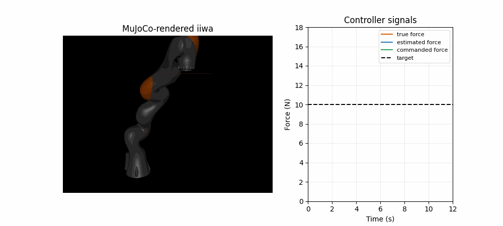
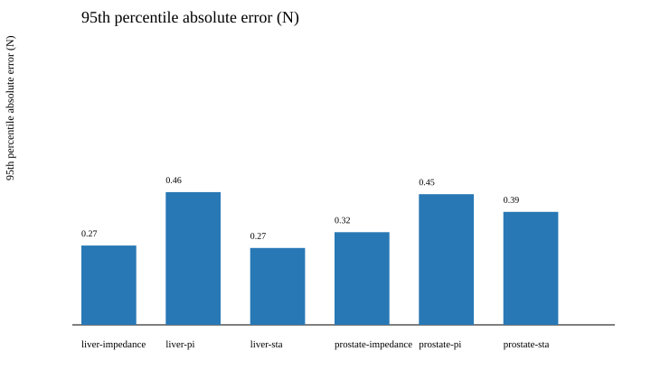
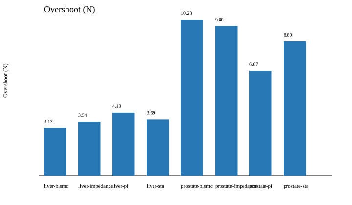
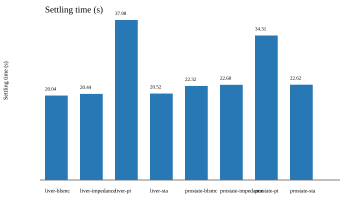

# Robotic ultrasound force-control study

This package is a reproducible MuJoCo-first study. It uses a 7-DoF
KUKA LBR iiwa 7 R800 MJCF model downloaded from the BSD-3-Clause
`mujoco_iiwa7_R800` repository and converted from the ROS `iiwa_stack` URDF,
1 ms MuJoCo integration, 2 ms controller updates, and explicit compliant
tissue force injected through `qfrc_applied`.
The nominal-vs-true force estimate includes noisy torque sensing and an
independent consistency estimate. The patient generator is calibrated to the
supplied paper context: 10 N target,
liver maxima 11.7–13.2 N, prostate maxima 13.4–21.3 N, and 5.8–12.1 mm
regular motion. Abrupt events are compressed by x20 (explicitly not clinical
time).

Commands:

* `python -m rusim.cli --fast --output results_fast` (6 s, 10 paired seeds)
* `python -m rusim.cli --rigorous --output results` (60 s, 10 paired seeds,
  held-out tuning, motion validation, estimation/safety/robustness studies)
* `python -m rusim.cli --rigorous --seeds 2 --duration 1 --output results_small`
  is a bounded end-to-end smoke suite.
* `python -m rusim.cli --stress --output results --seeds 3 --duration 8`
  runs adversarial breathing, tissue mismatch, mass mismatch, torque noise,
  sensor bias, and sensor dropout cases for all five controllers.

`results/` contains CSVs, saved gains, paired Wilcoxon/bootstrap statistics,
bring-up checks, motion validation, and SVG figures. `--backend surrogate`
selects the clearly labeled NumPy fallback.

The private LüGloMMa application package is kept outside this public
repository at `/home/laith/Downloads/lueglomma_application_private/`. It
contains the research proposal, motivation-letter draft, two-page CV
structure, technical brief, and submission checklist. These documents target
the Lübeck Innovation Hub for Robotic Surgery and the MSc Robotics and
Autonomous Systems. Replace all `[[...]]` placeholders with verifiable
applicant information before use.

## Controller metrics

Controllers are impedance, PI, super-twisting, barrier-Lyapunov sliding-mode
(`blsmc`), and barrier-Lyapunov super-twisting sliding-mode control
(`blf_stsmc`). The BLSMC law maps the force error into the
finite barrier coordinate
`xi = log((F-Fmin)/(Fmax-F))`, applies a bounded sliding correction, and keeps
the requested normal force inside the configured barrier window. A separate
force governor monitors both the reconstructed estimate and an independent force channel; when the 15 N
hard study limit is approached it commands active retraction. In safety-mode
stress tests, a separate force-envelope layer caps the force delivered to the
simulated robot at 15 N and logs the uncapped constitutive demand separately.
This makes the delivered-force bound explicit without pretending that the
uncapped tissue model is physically safe. It remains a simulation safety
mechanism, not a formal hardware certificate.

The BLF-STSMC variant uses the same barrier coordinate as its sliding variable
and applies a discrete super-twisting correction:
`u = Fd - k1*sqrt(|xi|)*sat(xi) + nu - 0.2*v_surface`,
`nu_dot = -k2*sat(xi)`. The boundary layer limits numerical chattering. It is
implemented as a sampled-data research controller and is not claimed to have
a full continuous-time invariance proof for the complete robot-tissue plant.

`results/metrics.csv` reports one row per organ, controller, and seed.
`rmse`, `mae`, `error_std`, and `p95_abs_error` quantify tracking accuracy and
tail risk. `overshoot`, `undershoot`, and `settling_time` quantify transient
behavior. `pct_above_11`, `pct_above_15`, and `time_above_15` quantify force
exposure. `effort` measures mean squared applied torque norm, while
`alarm_rate` and `retract_rate` quantify safety-monitor intervention.
The stress output additionally reports delivered-force guarding, raw tissue
demand, force-envelope violations, and maximum force excess.
`paired_statistics.csv` compares PI, super-twisting, and BLSMC results by
matched organ/seed with bootstrap intervals and a Wilcoxon test. The rigorous
benchmark uses a 1.15 trajectory-difficulty factor: faster abrupt events and
stronger drift/cough components than the baseline smoke suite.

`results/breathing_validation.csv` reports respiratory period, frequency,
amplitude, peak-to-peak displacement, peak velocity, and displacement RMS for
80 deterministic organ/seed cases. The breathing component is a
non-sinusoidal multi-harmonic surface motion with a randomized 3–5 s period.
The MuJoCo model also contains a non-colliding reference tissue plane for
visualization. The moving contact surface used by the force law is explicit:
its signed normal displacement and velocity are generated by `PatientMotion`,
and penetration is evaluated at the probe attachment site before applying the
rate-dependent tissue force. It is not a hidden rigid floor contact.

Final difficult-trajectory mean RMSE (N), averaged over 10 held-out seeds:

| Organ | Impedance | PI | STA | BLSMC | BLF-STSMC |
| --- | ---: | ---: | ---: | ---: | ---: |
| Liver | 0.253 | 0.348 | 0.277 | **0.184** | 0.253 |
| Prostate | 0.666 | **0.507** | 0.598 | 0.643 | 0.745 |

These are simulation-only results; the condition-dependent ranking is why
phantom calibration and staged hardware validation are part of the proposed
next phase.

Selected mean metrics from the same held-out runs:

| Organ | Controller | MAE (N) | P95 error (N) | Settling (s) | Time >15 N |
| --- | --- | ---: | ---: | ---: | ---: |
| Liver | Impedance | 0.125 | 0.276 | 20.438 | 0.0% |
| Liver | PI | 0.199 | 0.461 | 37.982 | 0.0% |
| Liver | STA | 0.153 | 0.266 | 20.524 | 0.0% |
| Liver | BLSMC | **0.053** | **0.097** | **20.042** | 0.0% |
| Liver | BLF-STSMC | 0.131 | 0.232 | 20.521 | 0.0% |
| Prostate | Impedance | 0.190 | 0.334 | 22.603 | 25.2% |
| Prostate | PI | 0.223 | 0.455 | 34.307 | **10.9%** |
| Prostate | STA | 0.210 | 0.409 | 22.619 | 21.2% |
| Prostate | BLSMC | **0.117** | **0.182** | **22.320** | 24.9% |
| Prostate | BLF-STSMC | 0.213 | 0.458 | 22.990 | 29.7% |

The hard stress matrix writes `results/stress_test.csv` and reports
`force_guard_rate`, `hard_limit_violation_rate`, `max_force_excess`,
`raw_force_demand_rate`, and `raw_max_force_excess`, as well as alarms and
retractions. A zero delivered-force violation rate means the force-envelope
layer held the simulated applied force below 15 N; raw demand metrics reveal
whether the tissue/trajectory combination would have exceeded it.
In the final 240-episode stress suite, delivered force reached at most 15.0 N
with zero violations; the stiff-tissue and combined-adversary cases produced
uncapped demands up to 23.7 N, with guard activation concentrated in those
cases.

## Visual outputs

The controller dashboard summarizes all five controllers across both organs:


The respiratory surface motion used in the experiments is:


The animation below is a playable GIF rendered by MuJoCo's offscreen renderer
from
the imported iiwa MJCF. It uses the same controller-to-force-to-joint-torque
path as the benchmark, and the companion
`robot_breathing_force_control.csv` records true force, estimated force, and
commanded normal force. It is a dynamic simulation visualization, not a
recorded hardware experiment.



[Download the MP4 version](results/animation/robot_breathing_contact.mp4).

The red semi-transparent object is a **visual tissue-surface proxy**. The
12-second animation uses a normal-aligned pose with the attachment site above
the block and the local Z axis directed downward. It follows
the explicit moving surface in the animation and is disabled for MuJoCo contact
(`contype="0"` and `conaffinity="0"`). The red marker at the end of the arm is
the `attachment_site`; the actual normal force is computed by the explicit
Kelvin--Voigt-like penalty law from penetration at this site and is then
converted to joint torque through its Jacobian. These are not a measured
tissue volume or a rigid colliding red block.

<details>
<summary>Individual metric visualizations</summary>

| Metric | Visualization |
| --- | --- |
| RMSE |  |
| MAE |  |
| 95th-percentile error |  |
| Overshoot |  |
| Settling time |  |
| Control effort |  |
| Time above 15 N |  |

</details>

Regenerate them with:

```bash
python3 scripts/make_public_plots.py
python3 scripts/render_animation.py --output-dir results/animation
```

Limitations: this remains simulation, the imported arm model is not an
official asset released by the paper authors or KUKA, force sensing is
reconstructed from simulated joint torques, and event compression changes
temporal statistics. The paper does not release a tissue FEM or constitutive
model; the explicit tissue law is a transparent simulation assumption. The
robustness sweep now applies stiffness, friction, mass, and torque-noise
perturbations. The explicit penalty contact includes a documented 40 N
numerical/physical envelope to prevent unstable rigid-body excursions from
becoming kilonewton artifacts; this is not a measured tissue limit. It is
still a compact model rather than hardware evidence.
Results do not
replace ROS 2, hardware-in-the-loop, calibration, or clinical validation.

The barrier coordinate follows the constrained-output Lyapunov construction
of Tee, Ge, and Tay, “Barrier Lyapunov Functions for the control of
output-constrained nonlinear systems,” *Automatica* 45 (2009), 918–927,
DOI: [10.1016/j.automatica.2008.11.017](https://doi.org/10.1016/j.automatica.2008.11.017).

## ROS 2 digital-twin package

The `ros2_ws/src/robotic_ultrasound_force_control` package adds a Foxy
interface around the same controller and MuJoCo model:

- `mujoco_node`: breathes the tissue surface, computes explicit contact force,
  publishes true/estimated force, surface velocity, and joint positions.
- `controller_node`: consumes estimated force and surface velocity, runs the
  selected controller, and publishes the desired normal force.
- `safety_node`: monitors estimated and independent force channels and publishes
  a guarded desired force plus guard status.

Build and run:

```bash
source_ros2
cd /home/laith/Downloads/robotic_ultrasound_force_control/ros2_ws
colcon build --symlink-install --packages-select robotic_ultrasound_force_control
source install/setup.bash
export RUSIM_PROJECT_ROOT=/home/laith/Downloads/robotic_ultrasound_force_control
ros2 launch robotic_ultrasound_force_control digital_twin.launch.py
```

Useful live checks:

```bash
ros2 topic list
ros2 topic echo /tissue/true_force std_msgs/msg/Float64
ros2 topic echo /ultrasound/safe_desired_normal_force std_msgs/msg/Float64
ros2 topic echo /ultrasound/safety_guard_active std_msgs/msg/Bool
```

This is a simulation ROS 2 interface, not a robot-driver integration. Hardware
requires replacing `mujoco_node` with a real force-sensor and joint-state
interface and independently validating signal timestamps, calibration, limits,
emergency stop, and torque commands.

## Mathematical model

### Moving tissue surface

The probe attachment site has vertical position $z_p(t)$. The moving tissue
surface is represented by an explicit signed normal displacement:

$$
z_s(t)=z_0+z_{\mathrm{resp}}(t)+z_{\mathrm{drift}}(t)
       +z_{\mathrm{event}}(t)+z_{\mathrm{cardiac}}(t).
$$

Penetration and surface velocity are

$$
p(t)=\max(0,z_p(t)-z_s(t)), \qquad v_s(t)=\dot z_s(t).
$$

The contact law is a bounded nonlinear Kelvin--Voigt-like penalty model:

$$
F_{\mathrm{raw}} =
k\,p(1+0.2p)+c\,v_s,\qquad
F_{\mathrm{tissue}}=\min(40,\max(0,F_{\mathrm{raw}})).
$$

The nominal parameters are $k=1000\ \mathrm{N/m}$ and
$c=8\ \mathrm{N\,s/m}$. Ten millimetres of static penetration therefore
produces approximately 10 N. The 40 N limit is a numerical model envelope,
not a clinical tissue limit. In safety-mode stress tests, a separate delivered
force envelope uses 15 N and records uncapped tissue demand separately.

### Barrier coordinate

The target force is $F_d=10$ N and the barrier interval is
$[F_{\min},F_{\max}]=[6,14]$ N. The logarithmic barrier coordinate is

$$
\xi(F)=\log\left(\frac{F-F_{\min}}{F_{\max}-F}\right).
$$

The measured force is clipped only inside the open interval for numerical
stability. As $F$ approaches either boundary, $|\xi|$ grows, so the
controller produces a corrective command before the force reaches the
barrier.

### Controllers

The BLSMC command is

$$
u_{\mathrm{BL}}=F_d-k_b\tanh(\xi)
-k_s\operatorname{sat}(\xi/\phi)-0.2v_s.
$$

The BLF-STSMC command uses the same barrier coordinate as its sliding variable:

$$
s=\xi,\qquad
u_{\mathrm{BLF-ST}}=F_d-k_1\sqrt{|s|}\operatorname{sat}(s/\phi)
+\nu_k-0.2v_s,
$$
$$
\nu_{k+1}=\nu_k-k_2\operatorname{sat}(s/\phi)\Delta t.
$$

This is a sampled-data implementation. It is not a formal continuous-time
invariance proof for the complete robot, actuator, estimator, and tissue
dynamics.

### Robot torque mapping

The desired normal force is mapped through the attachment-site Jacobian:

$$
\tau_{\mathrm{normal}}=J_z(q)^\mathsf{T}u.
$$

Posture stabilization and the imported iiwa actuator limits are applied before
the torque is submitted to MuJoCo through `qfrc_applied`.

## Results discussion

The evaluation uses held-out seeds: gains are selected on seeds 100--104 and
the reported benchmark uses seeds 0--9. Each organ/controller pair therefore
contains ten 60-second MuJoCo episodes with a 1.15 trajectory-difficulty
factor.

### Tracking

BLSMC is the strongest liver controller: it reduces RMSE to 0.184 N and MAE
to 0.053 N. PI is the best prostate controller by RMSE at 0.507 N, while
BLSMC has the lowest prostate MAE and 95th-percentile error. This distinction
matters: RMSE rewards average tracking, while tail error exposes intermittent
force excursions.

BLF-STSMC is a genuine combined barrier/super-twisting implementation, but
the current sampled gains do not improve the study ranking. Its liver RMSE is
0.253 N and prostate RMSE is 0.745 N. It should therefore be reported as a
validated research candidate requiring further gain and model analysis, not
as a superior controller.

### Force exposure and safety

The ordinary benchmark intentionally reports the controllers without the
15 N delivered-force envelope, so prostate threshold exposure and violations
remain visible. PI has the lowest prostate exposure at 10.9%; BLF-STSMC has
the highest at 29.7%. The separate 240-episode safety stress suite enables
the envelope and records zero delivered-force violations for every controller.
The uncapped tissue demand reaches 23.7 N in stiff-tissue and combined
adversary cases. This separates controller tracking from the safety
supervisor's intervention capability.

### Interpretation

There is no universal winner. The liver motion regime favors BLSMC's
barrier-shaped correction; the prostate regime favors PI on RMSE and threshold
exposure, while BLSMC retains better tail-error behavior. The result supports
condition-aware controller selection and motivates phantom calibration rather
than a claim of clinical superiority. All results remain simulation evidence:
the tissue law, reconstructed sensing, force thresholds, and event
compression require experimental validation.
